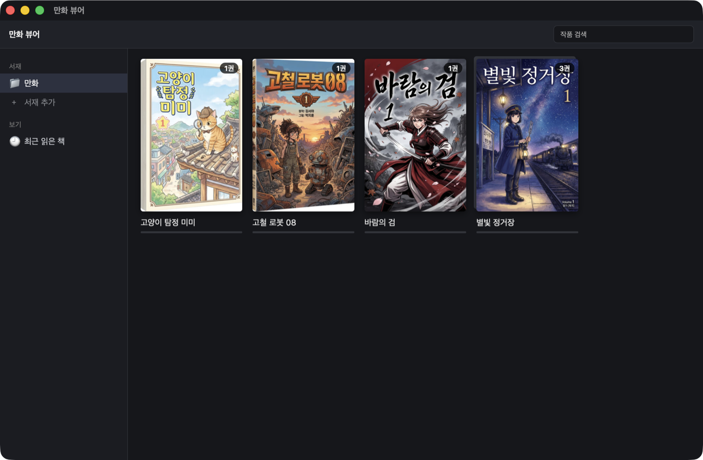
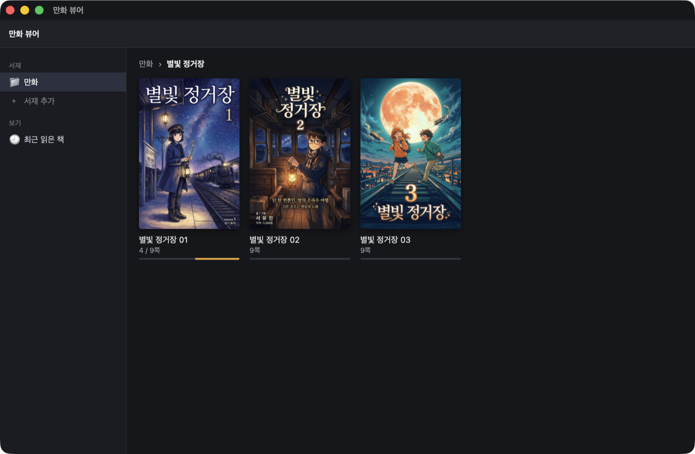

# 만화 뷰어 (Comics Viewer)

ZIP으로 묶은 만화책을 책장처럼 정리해서 읽는 데스크톱 앱입니다. 내 컴퓨터의 폴더뿐 아니라 SSH로 접속하는 서버의 폴더도 서재로 추가할 수 있습니다. [Tauri 2](https://tauri.app)(Rust + React)로 만들었습니다.



## 기능

- **책장**: 폴더를 고르면 하위 폴더까지 ZIP·CBZ를 찾아 작품별로 묶고 표지를 보여 줍니다. 작품을 열면 권별 표지와 읽은 위치가 나옵니다.
- **두 쪽 펼침**: 종이 책처럼 두 쪽씩 보여 줍니다. 표지와 가로로 긴 펼침 그림은 한 장으로 크게 나옵니다. 한 쪽 보기로 바꾸거나 짝을 한 쪽 밀 수도 있습니다.
- **일본 만화 / 한국 만화 방향**: 기본은 일본 만화(오른쪽에서 왼쪽, `←`가 다음 쪽)입니다. 한국 만화(왼쪽에서 오른쪽, `→`가 다음 쪽)로 서재·작품·권 단위로 바꿀 수 있습니다.
- **이어 읽기**: 권마다 읽은 쪽을 기억하고, 마지막 쪽에서 넘기면 다음 권으로 이어집니다. 최근 읽은 책 목록도 있습니다.
- **SSH 서버**: `~/.ssh/config`에 등록한 호스트를 그대로 고릅니다. ssh-agent → 키 파일 → 비밀번호 순으로 로그인하고, 암호와 비밀번호는 키체인에 저장할 수 있습니다. 호스트 키는 `~/.ssh/known_hosts`로 확인합니다. ZIP 전체를 내려받지 않고 필요한 부분만 읽어서, 큰 파일도 바로 열립니다.
- 파일 이름이 CP949(EUC-KR)로 저장된 오래된 ZIP도 한글이 깨지지 않습니다.

| 작품의 권 목록 | 읽는 화면 |
|---|---|
|  |  |

스크린샷의 만화는 데모용으로 AI가 그린 가상의 작품입니다.

## 설치

[Releases](https://github.com/gcjjyy/comics_viewer/releases)에서 운영체제에 맞는 파일을 받습니다.

| 운영체제 | 파일 |
|---|---|
| macOS (Apple Silicon) | `ComicsViewer_…_aarch64.dmg` |
| Windows (64비트) | `ComicsViewer_…_x64-setup.exe` 또는 `.msi` |
| Linux (64비트) | `.AppImage`, `.deb`, `.rpm` 중 하나 |

개발자 서명을 하지 않은 앱이라 처음 실행할 때 운영체제가 막을 수 있습니다.

- **macOS**: `Comics Viewer`를 응용 프로그램 폴더로 옮긴 뒤 터미널에서 아래 명령을 한 번 실행하고 여세요.

  ```sh
  xattr -dr com.apple.quarantine "/Applications/Comics Viewer.app"
  ```

- **Windows**: "Windows의 PC 보호" 창이 뜨면 `추가 정보` → `실행`을 누르세요.

## 사용법

왼쪽의 **서재 추가**에서 `내 컴퓨터` 또는 `SSH 서버`를 고르고 만화가 들어 있는 폴더를 지정합니다. SSH 서버 탭에서는 경로 칸에 원하는 경로를 직접 입력해 이동할 수도 있습니다.

작품은 이렇게 묶습니다.

- ZIP이 들어 있는 폴더 하나가 작품 하나입니다. 서재 맨 위에 있는 ZIP은 그 자체로 작품 하나입니다.
- ZIP 안에 이미지 폴더가 두 개 이상 있으면 폴더마다 한 권으로 나눕니다.
- 권과 쪽은 숫자를 고려한 순서(2권이 10권보다 앞)로 정렬합니다.

### 읽는 화면 조작

| 키·마우스 | 동작 |
|---|---|
| `←` `→` | 쪽 넘기기 (방향은 일본/한국 만화 설정을 따름) |
| `Space` / `Shift+Space` | 다음 쪽 / 이전 쪽 |
| 화면 왼쪽·오른쪽 클릭 | 그쪽으로 넘기기 |
| 마우스 휠 | 다음 쪽 / 이전 쪽 |
| 아래 진행 막대 클릭 | 그 위치로 이동 |
| `D` | 이 권의 읽는 방향 바꾸기 |
| `S` | 한 쪽 / 두 쪽 보기 |
| `A` | 펼침 짝을 한 쪽 밀기 |
| `F` | 전체 화면 |
| `Esc` | 책장으로 |

작품이나 서재를 오른쪽 클릭하면 그 단위의 읽는 방향을 정할 수 있습니다.

## 직접 빌드

[Rust](https://rustup.rs)와 [Bun](https://bun.sh)이 필요합니다.

```sh
bun install
bun run tauri dev      # 개발 모드로 실행
bun run tauri build    # 배포용 앱 만들기 (src-tauri/target/release/bundle)
```

테스트:

```sh
bun run test                          # 화면
cd src-tauri && cargo test --lib      # Rust
```

## 라이선스

[MIT](LICENSE)
